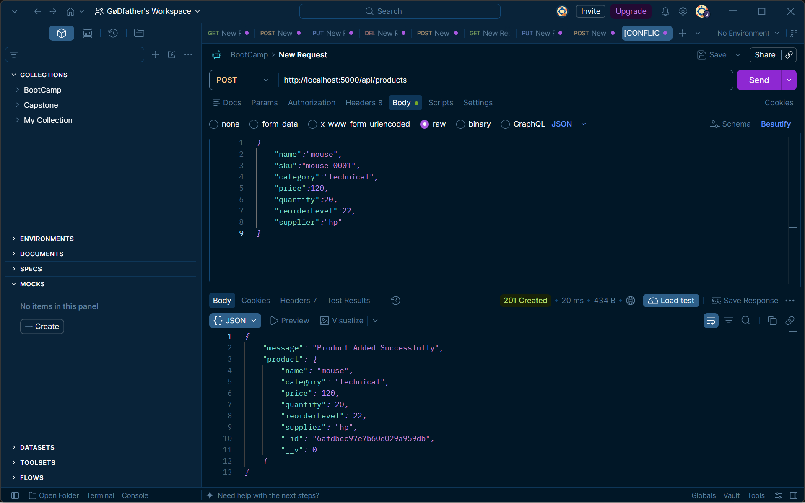
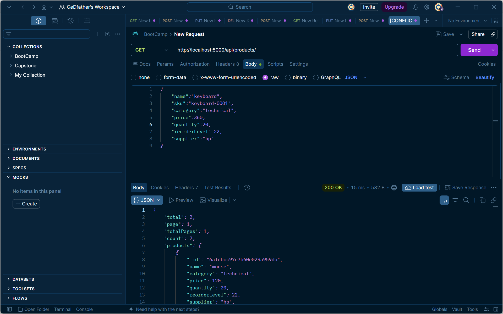
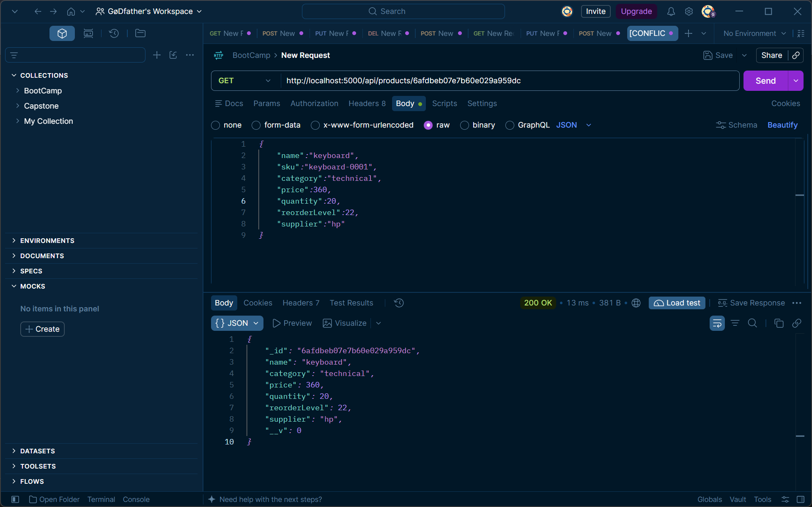
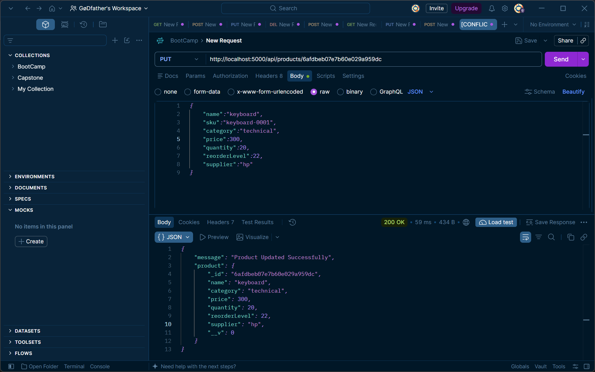
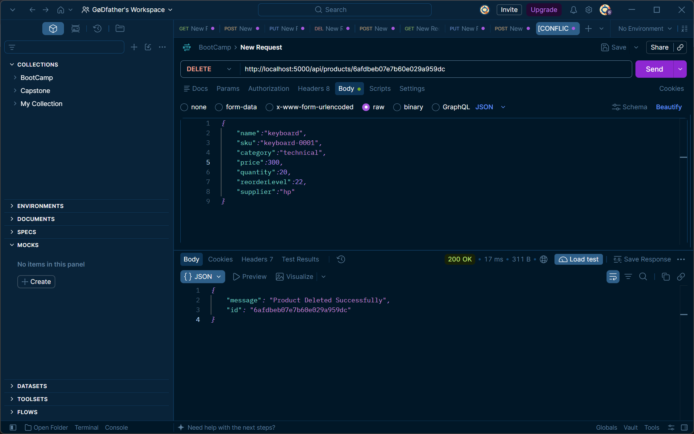
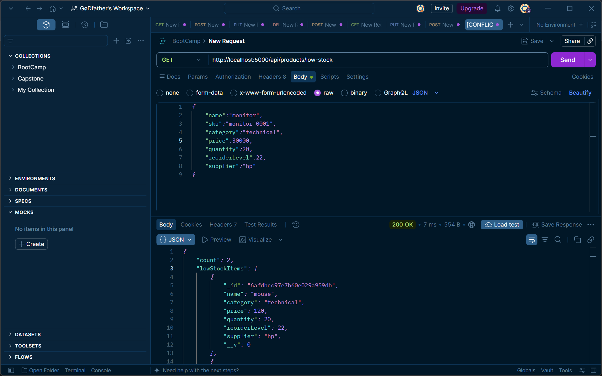

# Inventory Management System

## API Documentation

### 1. Create Product
**POST** `/api/products/`

### 2. Get All Products
**GET** `/api/products/`

### 3. Get Single Product
**GET** `/api/products/:id`

### 4. Update Product
**PUT** `/api/products/:id`

### 5. Delete Product
**DELETE** `/api/products/:id`

### 6. Low Stock Report
**GET** `/api/products/low-stock`

### 7. Category Summary
**GET** `/api/products/category-summary`

